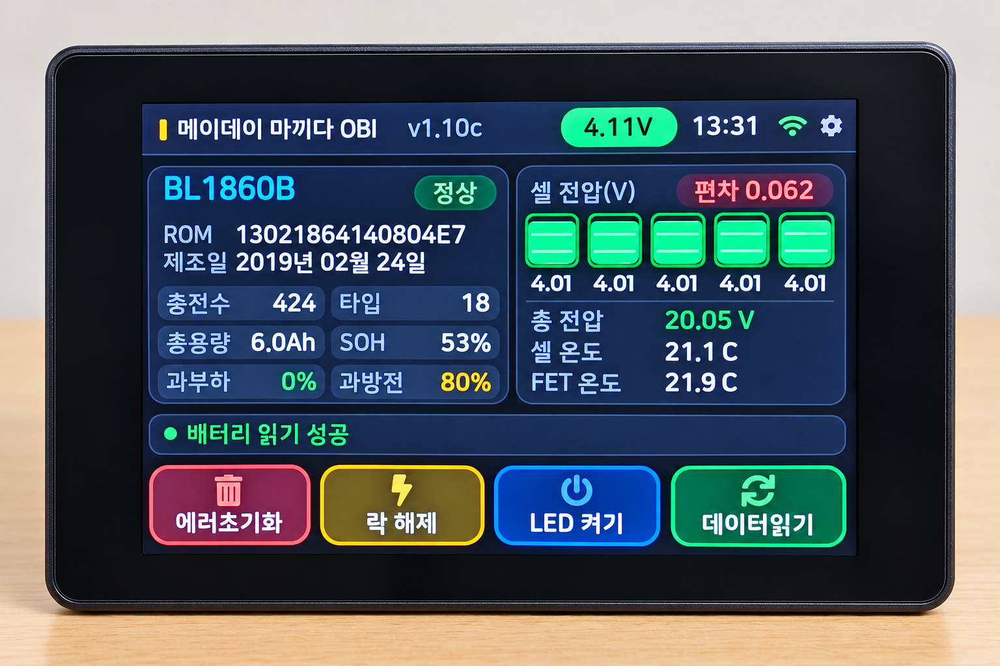

# MAYDAY OBI

**마끼다 LXT 배터리 진단용 ESP32-S3 3.5인치 터치스크린 프로젝트**

**[MAYDAY OBI 홈페이지 바로가기](https://maydaycom.github.io/mayday-obi/)** · [배터리스트 메이데이 YouTube](https://www.youtube.com/@batterist_mayday)

## 2026-11-12 · 홈페이지 화면 개선 / Homepage design update

- 첫 화면의 반복 문구와 여백을 줄이고 **USB로 설치** 버튼을 눈에 잘 띄게 배치했습니다.
- USB 설치 절차, 주의사항, 확인 체크박스를 한곳에 정리했습니다. 보드 구매처와 마끼다 통신단자 링크는 연한 녹색 버튼으로 표시합니다.
- Reduced repeated copy and spacing on the homepage and made **Install over USB** the primary action.
- Grouped the installation steps, precautions, and confirmation checkbox. The board and Makita connector links use pale green buttons.

[화면 변경 커밋 / Design commit](https://github.com/MayDayCom/mayday-obi/commit/2a69425051f909848a8f2e81e34c0c68ad36354a) · [이전 홈페이지 백업 / Previous design backup](https://github.com/MayDayCom/mayday-obi/tree/backup/before-workbench-design-20261112)

## 펌웨어 상태

**펌웨어 배포 중**

ESP32-S3용 펌웨어가 GitHub에 등록되어 있습니다. **현재 버전은 [홈페이지의 USB 펌웨어 설치 영역](https://maydaycom.github.io/mayday-obi/#firmware)에서 자동으로 확인**할 수 있습니다.

[펌웨어 파일과 설치 안내](firmware/)

## USB 설치 집계 / USB install count

- 홈페이지에서 USB 최초 설치·복구 또는 업데이트가 완료될 때 Cloudflare Workers와 D1으로 집계합니다. 같은 기기에 다시 설치하면 별도 건으로 집계합니다.
- The website records completed USB installs, recoveries, and updates in Cloudflare D1 through a Worker. Repeat installs count separately.
- [설치 건수 갱신 안내 / Install count refresh](docs/usb-install-count.md)

## v1.10v · 모바일 배터리 상태 화면 / Mobile battery dashboard

**빌드 / Build `2026.11.11-1804`**

- 스마트폰에서 팩 전압, 잠금 상태, 셀 전압 5개와 조작 버튼을 화면 상단에서 바로 확인할 수 있습니다. 상세 수치는 한 줄씩 정리했습니다.
- On phones, pack voltage, lock status, all five cell voltages, and battery controls appear near the top. Other readings use compact rows.

## v1.10v · 영문 표시 보완 / English display fixes

**빌드 / Build `2026.11.10-1546` · 버전은 v1.10v로 유지합니다. / Version remains v1.10v.**

- ENG 제조일을 `10 Nov 2026` 형식으로 표시합니다. 배터리를 다시 읽지 않아도 언어 전환 즉시 날짜 표시가 바뀝니다.
- Wi-Fi 검색 결과와 웹 페이지 제목의 누락 번역을 추가하고, 긴 상태 문구가 잘려 번역되지 않던 문제를 수정했습니다. F0513의 영문 안내를 읽기 전용으로 바로잡았습니다.
- 최대 4KB USB 전송 및 소수점 한 자리 진행률 처리는 유지합니다.

- ENG manufacture dates use `10 Nov 2026`. Switching languages updates the date immediately without another battery read.
- Added missing Wi-Fi search and web-page title translations, prevented truncated status messages from bypassing translation, and corrected the F0513 read-only description.
- USB transfers still support up to 4KB per block and progress retains one decimal place.

## v1.10v · USB 업데이트 속도 개선

**빌드 `2026.11.10-1502`**

- 기기의 수신 버퍼에 맞춰 최대 4KB씩 전송해 응답을 기다리는 횟수를 줄였습니다.
- USB 수신 중 화면 갱신과 주변 작업의 대기를 줄이고, 웹 진행률은 최대 초당 10회 갱신합니다. 퍼센트는 소수점 한 자리로 표시합니다.
- 기존 기기가 알리는 1KB·128바이트 전송도 지원합니다. v1.10v를 설치한 기기는 다음 업데이트부터 개선된 4KB 전송을 사용할 수 있습니다.
- 최초 설치는 `firmware.factory.bin`, 기존 기기의 업데이트는 `firmware.bin`을 사용합니다.

**Build `2026.11.10-1502`**

- Transfers negotiate up to 4KB per block according to the device's receive buffer, reducing acknowledgement waits.
- The device prioritizes USB reception while periodically refreshing its display. Web progress refreshes up to 10 times per second and retains one decimal place.
- Existing 1KB and 128-byte receivers remain supported. Devices running v1.10v can use the improved 4KB transfer mode for subsequent updates.
- Use `firmware.factory.bin` for first installation and `firmware.bin` for updates.

## v1.10u 변경 사항 · What's new

**빌드 `2026.11.07-0945`**

- **본체 전압 표시** — OBI 전원용 배터리 전압을 읽을 수 없으면 상단에 `-- V`로 표시합니다. 전압이 읽히면 기존처럼 숫자로 표시합니다.
- **잠금 이력** — 기기에서 **데이터읽기**를 하면 잠금 원인이 확인된 팩만 ROM ID별로 저장합니다. **락 해제** 결과는 전후 상태 코드와 잠금 원인을 같은 기록에 남깁니다. 최근 32건은 기기에 저장되어 재부팅 후에도 남습니다.
- **CSV 현지 시각** — 기기에서 **펌웨어 업데이트 & 배터리 상태 확인**을 시작한 뒤 같은 Wi-Fi에서 기기 주소를 열고 **잠금 및 해제 기록**에서 팩을 선택합니다. **CSV 다운로드**를 누르면 브라우저의 시간대 기준으로 `YYYY-MM-DD HH:mm:ss` 형식의 시각이 저장됩니다. 기기 시각을 확인할 수 없었던 기록은 시각을 빈칸으로 표시합니다.
- **화면보호기** — 기기 시각이 유효해지기 전에는 **MAYDAY OBI** 로고가 천천히 움직입니다. 유효한 시각이 있으면 시계를 표시하며, Wi-Fi가 끊겨도 기기 시계가 유효한 동안 계속 표시합니다. **화면 보호 설정 → 미리보기**에서 확인할 수 있습니다.
- **진단 표시** — 상태 배지와 Wi-Fi 배터리 화면에서 잠금 원인을 볼 수 있습니다. 오류 초기화는 전후 상태를 화면에 표시하며, Wi-Fi 페이지 하단에서 최근 디버그 로그를 볼 수 있습니다.

**Build `2026.11.07-0945`**

- **Board battery voltage** — The top bar shows `-- V` when the OBI's own battery voltage is unavailable. A valid reading still appears as a voltage.
- **Lock history** — OBI records the last 32 abnormal reads by battery ROM ID. An unlock attempt adds the before-and-after status codes, lock causes, and outcome to the same record. History survives a reboot.
- **Local CSV timestamps** — Start **Firmware Update & Battery Status** on the device and open its address on the same Wi-Fi network. Select a pack under **Lock and unlock history**, then choose **Download CSV**. Times use the browser's time zone in `YYYY-MM-DD HH:mm:ss` format. Entries without a valid device time have blank timestamps.
- **Screensaver** — The **MAYDAY OBI** logo moves across the screen until the device has a valid time. The clock then appears and keeps running if Wi-Fi disconnects. Check it under **Display → Preview**.
- **Diagnostics** — View lock causes and before-and-after error-reset results on the device or the Wi-Fi dashboard. Recent device events appear in the web debug log.

## 사용 보드와 연결

- ESP32-S3 3.5인치 터치스크린 보드
- **P2:** IO5 → DATA, IO6 → ENABLE
- **P3:** GND → 배터리 B−, 3.3V → 4.7kΩ 저항 → DATA
- **18V B+를 ESP32에 직접 연결하지 마세요.**

[실제 보드 후면 사진](assets/esp32-s3-3.5-back.jpg) · [마끼다 LXT 배선도](https://maydaycom.github.io/mayday-obi/#wiring) · [사용 보드 구매처](https://s.click.aliexpress.com/e/_c4VYI0z1)

연결 전에 사용 중인 보드의 핀 방향과 펌웨어 설정을 확인하세요.

## 보드 전원: USB-C 또는 리튬이온 배터리

- **USB-C:** 5V 전원 공급 및 보드 충전회로를 통한 1셀 배터리 충전
- **P5 (JST 1.25mm 2핀):** 보호회로가 있는 1셀(1S) 3.7V 리튬이온/리튬폴리머 배터리
- **전원 2가닥:** 배터리 `+` → **P5 +**, 배터리 `−` → **P5 −**.
- **전압 측정 2가닥:** 배터리 `+` → **R1 100kΩ** → 공통 분압점, 배터리 `−` → **R2 100kΩ** → **같은 공통 분압점**.
- **ADC 연결:** 두 저항이 만나는 분압점에서 **IO9 한 곳에만 연결**합니다. **IO14는 연결하지 않습니다.**
- 현재 `main.cpp`의 `PIN_BAT_ADC = 9`, `BAT_DIV = 2.0` 설정에 맞춘 회로입니다.
- **P5 극성:** USB-C 쪽이 `+`, 반대쪽이 `−`입니다. 실제 기판 극성을 먼저 확인하세요.
- 배터리만 연결했을 때 필요하면 보드의 **Battery switch** 버튼을 누릅니다.
- 2셀 이상 직렬 연결이나 마끼다 LXT 18V를 P5에 직접 연결하지 마세요.

[배터리 전원 및 IO9 전압 측정 연결도](https://maydaycom.github.io/mayday-obi/#battery-power)

## BMS 지원 참고

마끼다 **LXT 전용**입니다. 지원 기판 목록은 [원본 OBI의 Makita Wiki](https://github.com/mnh-jansson/open-battery-information/wiki/Makita)를 참고하세요. 해당 목록은 **MAYDAY OBI 펌웨어 자체의 호환성 검증 결과가 아닙니다.**

## 자료 출처

MAYDAY OBI는 **Martin Jansson**의 [Open Battery Information](https://github.com/mnh-jansson/open-battery-information)을 바탕으로 제작한 비공식 프로젝트입니다.

원본 OBI: [MIT License](https://github.com/mnh-jansson/open-battery-information/blob/main/LICENSE.md) · Copyright (c) 2024 Martin Jansson.

참고: [KST Makita 프로젝트](https://ai.kenhsangtao.com/makita/). 본 프로젝트는 Makita의 공식 제품이나 후원 프로젝트가 아닙니다.
