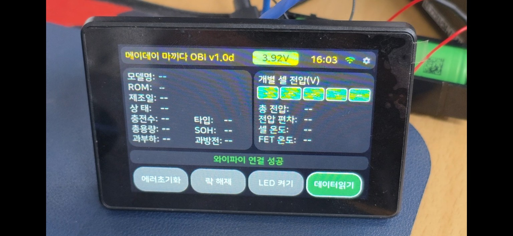

# MAYDAY OBI

**마끼다 LXT 배터리 진단용 ESP32-S3 3.5인치 터치스크린 프로젝트**

**[MAYDAY OBI 홈페이지 바로가기](https://maydaycom.github.io/mayday-obi/)** · [배터리스트 메이데이 YouTube](https://www.youtube.com/@batterist_mayday)

## 펌웨어 상태

**배포 준비 중** — 다운로드 파일과 웹 설치 기능은 아직 공개되지 않았습니다.

## 사용 보드와 연결

- ESP32-S3 3.5인치 터치스크린 보드
- **P2 (8핀):** IO5 → DATA, IO6 → ENABLE
- **P3 (4핀):** GND → 배터리 B−, 3.3V → 4.7kΩ 저항 → DATA
- **18V B+를 ESP32에 직접 연결하지 마세요.**

[실제 보드 후면 사진](assets/esp32-s3-3.5-back.jpg) · [마끼다 LXT 배선도](https://maydaycom.github.io/mayday-obi/#wiring) · [사용 보드 구매처](https://s.click.aliexpress.com/e/_c4naCAr1)

연결 전에 사용 중인 보드의 핀 방향과 펌웨어 설정을 확인하세요.

## 보드 전원: USB-C 또는 리튬이온 배터리

- **USB-C:** 5V 전원 공급 및 내장 충전회로를 통한 배터리 충전
- **P5 (JST 1.25mm 2핀):** 보호회로가 있는 1셀(1S) 3.7V 리튬이온/리튬폴리머 배터리
- **배터리에서 총 4가닥:** `+` 두 가닥, `−` 두 가닥을 각각 분기합니다.
- **전원 2가닥:** 배터리 `+` → **P5 +**, 배터리 `−` → **P5 −**.
- **전압 측정 2가닥:** 배터리 `+` → **R1 100kΩ** → **P2 7번 IO9**, 배터리 `−` → **R2 100kΩ** → **같은 P2 7번 IO9**.
- 두 저항선의 끝은 **하나의 IO9 측정점**으로 합쳐져야 합니다. 서로 다른 GPIO에 연결하거나 IO9에 배터리 `+`를 직접 연결하지 마세요.
- **P5 극성:** USB-C 쪽이 `+`, 반대쪽이 `−`입니다. 실제 기판의 실크스크린을 확인하세요.
- 전압 표시는 제공된 `main.cpp`의 `PIN_BAT_ADC = 9`, `BAT_DIV = 2.0` 설정을 따릅니다. IO5는 마끼다 DATA 통신에 사용됩니다.
- 배터리만 연결했을 때 필요하면 보드의 **Battery switch** 버튼을 누릅니다.
- 2셀 이상 직렬 연결 또는 마끼다 18V를 P5에 직접 연결하지 마세요.

[실제 후면 사진을 포함한 전원 배선도](https://maydaycom.github.io/mayday-obi/#battery-power)

## BMS 지원 참고

마끼다 **LXT 전용**입니다. 지원 기판 목록은 [원본 OBI의 Makita Wiki](https://github.com/mnh-jansson/open-battery-information/wiki/Makita)를 참고하세요. 해당 목록은 **MAYDAY OBI 펌웨어 자체의 호환성 검증 결과가 아닙니다.**

## 자료 출처

MAYDAY OBI는 **Martin Jansson**의 [Open Battery Information](https://github.com/mnh-jansson/open-battery-information)을 바탕으로 제작한 비공식 프로젝트입니다.

원본 OBI: [MIT License](https://github.com/mnh-jansson/open-battery-information/blob/main/LICENSE.md) · Copyright (c) 2024 Martin Jansson.

참고: [KST Makita 프로젝트](https://ai.kenhsangtao.com/makita/). 본 프로젝트는 Makita의 공식 제품이나 후원 프로젝트가 아닙니다.
